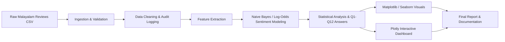

# Project 08: Malayalam Movie Review Sentiment Polarity & Morphological Profiler

[](https://duk.ac.in)
[](https://python.org)
[](LICENSE)

## 1. Project Overview & Domain Context

- **Institution:** Digital University Kerala (MTech AI / MSc AI)
- **Course:** M4010104 / M4020104 — Programming in Python
- **Instructor:** Dr. Sunil TT
- **Dataset:** Malayalam Movie Review Sentiment Dataset on Kaggle — https://www.kaggle.com/datasets/abhijith7711/malayalam-movie-review-dataset
- **Effort Budget:** 10–12 Hours
- **Max Marks:** 25
- **Core Stack:** Pure Python, NumPy, Pandas, Matplotlib, Seaborn, Plotly

Malayalam cinema audiences share vivid, nuanced critiques on digital review forums using colloquial idioms, sarcasm, expressive punctuation, and morphological richness. This project focuses on building a modular Python-based sentiment and morphological analysis pipeline to analyze informal Malayalam movie reviews and classify them as positive or negative using character-level and lexical signals.

The system parses raw Malayalam review text, validates malformed entries, extracts morphological features such as vowels, consonants, conjuncts, and chillaksharams, and then applies a pure NumPy Multinomial Naive Bayes / log-odds classifier to quantify polarity. The project also requires rich visualization and reporting to answer a structured set of 12 analytical questions.

### Primary Data Schema

The public dataset contains the following fields:

- **Raw Feature Attributes:**
  - `Review` — colloquial Malayalam text
  - `Sentiment` — `Positive` / `Negative`
- **Engineered / Target Variables:**
  - `char_count`
  - `word_count`
  - `chillaksharam_count`
  - `vowel_sign_count`
  - `log_odds_score`
  - `predicted_class`

## 2. System Architecture & Pipeline Design

The repository is expected to be organized as a production-style Python project with separated responsibilities for ingestion, analysis, visualization, and documentation.

```text
malayalam-movie-review-analyzer/
├── README.md
├── requirements.txt
├── run_pipeline.py
├── data/
│   ├── raw/
│   │   └── malayalam_movie_reviews_raw.csv
│   └── processed/
│       ├── clean_malayalam_movies.csv
│       └── movie_reviews_audit.log
├── src/
│   ├── __init__.py
│   ├── ingestion.py
│   ├── analyzer.py
│   └── visualizer.py
├── notebooks/
│   └── development_cycle.ipynb
├── reports/
│   ├── figures/
│   │   ├── primary_envelope.png
│   │   ├── correlation_heatmap.png
│   │   └── distribution_regimes.png
│   ├── interactive_dashboard.html
│   └── Project_Report.pdf
└── LICENSE
```

### Pipeline Flow



## 3. Installation & Environment Setup

```bash
git clone https://github.com/<your-team>/malayalam-movie-review-analyzer.git
cd malayalam-movie-review-analyzer
python -m venv venv
source venv/bin/activate    # On Windows: venv\Scripts\activate
pip install -r requirements.txt
```

### Required dependencies

```text
numpy
pandas
matplotlib
seaborn
plotly
jupyter
```

## 4. Execution Instructions

### A. Running the standalone application

```bash
python run_pipeline.py \
  --input data/raw/malayalam_movie_reviews_raw.csv \
  --output-dir data/processed \
  --report-dir reports
```

This end-to-end pipeline should:

- read raw review records line by line
- validate and filter malformed input
- export a clean CSV file to `data/processed/clean_malayalam_movies.csv`
- generate an audit log at `data/processed/movie_reviews_audit.log`
- save standardized static figures under `reports/figures/`
- generate an interactive Plotly dashboard at `reports/interactive_dashboard.html`
- print progress messages and exit with status code `0` on success

### B. Running the development notebook

```bash
jupyter notebook notebooks/development_cycle.ipynb
```

The notebook should capture the full engineering lifecycle, including exploratory analysis, mathematical validation, model refinement, visualization prototyping, and unit tests.

## 5. Key Analytical & Statistical Findings (Q1–Q12 Summary)

This project is designed to answer the following research questions and technical tasks:

| Q# | Topic | Technical Requirement |
| :--- | :--- | :--- |
| Q1 | File I/O & Exception Handling | Parse review lines with `open()`, validate minimum length, Unicode integrity, and reject malformed records using `try-except` |
| Q2 | Data Curation & Audit Logging | Export a cleaned review corpus and log duplicates, one-word reviews, and non-Malayalam entries |
| Q3 | OOP Design | Build a `MovieReviewSentimentClassifier` class with `load_from_csv()`, `train_naive_bayes()`, and `summary_report()` |
| Q4 | NumPy Feature Extraction | Extract vowel sign and chillaksharam features using NumPy + regex character matching and verify with `np.allclose()` |
| Q5 | High-Confidence Masking | Flag high-confidence positive/negative reviews using probability thresholds and compare conjunct counts across classes |
| Q6 | Regression Analysis | Fit an OLS model using `np.linalg.lstsq()` to relate word count/chillaksharam frequency to sentiment intensity |
| Q7 | Pandas Class Balance & OOV | Quantify positive/negative class balance, vocabulary coverage, and OOV rate |
| Q8 | Review Length Discretization | Use `pd.cut()` and `pivot_table(margins=True)` to analyze sentiment proportions by short/medium/long reviews |
| Q9 | Morphological Feature Ranking | Use `pd.melt()` and `.groupby()` to reshape character metrics and identify top 5 complex reviews |
| Q10 | Matplotlib Opinion Word Charts | Generate horizontal bar charts for top opinion words with blue/red polarity coding |
| Q11 | Seaborn Violin & Heatmap | Compare morphological frequencies between positive and negative reviews and overlay a confusion matrix |
| Q12 | Plotly Dashboard | Create an interactive HTML dashboard for review polarity in a 2D feature space |

### Example summary table format

| Metric | Description |
| :--- | :--- |
| Raw Review Count | Total records ingested before validation |
| Clean Review Count | Records retained after filtering |
| Rejected Records | Malformed, duplicate, or non-Malayalam entries removed |
| Class Balance | Positive vs. negative review proportions |
| Feature Correlations | Relationships between morphology and sentiment intensity |
| OLS Coefficients | Regression values for word count and chillaksharam frequency |
| Top Morphological Drivers | Features most associated with sentiment polarity |

## 6. Standalone Interactive Visualizations

The project must generate a standalone Plotly dashboard as an offline HTML artifact for interactive exploration.

- **Output file:** `reports/interactive_dashboard.html`
- **Features:**
  - scatter plot of reviews in feature space
  - length vs. sentiment score
  - hover tooltips with metadata
  - polarity filters and interactive controls
  - viewable in any standard web browser without a server

In addition, the project requires publication-quality static visual outputs:

- `reports/figures/primary_envelope.png`
- `reports/figures/correlation_heatmap.png`
- `reports/figures/distribution_regimes.png`

These visual assets should communicate sentiment intensity, morphology patterns, and distribution shifts across positive/negative segments.

## 7. Contributor Git Commit & Pull Request Log Table

Professional team-based development is mandatory. Teams must initialize a GitHub repository, protect the main branch, assign team members as contributors, and maintain a clean PR trail with individual code ownership.

| Contributor Name | GitHub Handle | Assigned Module / Tasks | Verified Commit Hash Range | Merged Pull Request |
| :--- | :--- | :--- | :--- | :--- |
| [Student Full Name] | `@github_handle` | Modular Architecture (`src/ingestion.py`, `src/analyzer.py`) | `abc1234` → `def5678` | `#PR-01` |
| [Student Full Name] | `@github_handle` | Visualization & Reporting (`src/visualizer.py`, `reports/`) | `ghi9012` → `jkl3456` | `#PR-02` |
| [Student Full Name] | `@github_handle` | Notebook, validation, documentation, final QA | `mno7890` → `pqr1234` | `#PR-03` |

### Required Git workflow expectations

- initialize GitHub repository on Day 1
- protect `main` from direct pushes
- create separate feature branches such as:
  - `feature/ingestion`
  - `feature/analysis`
  - `feature/visualization`
- make small atomic commits
- merge via formal pull requests with peer review
- maintain an auditable commit trail for viva examination

## 8. Evaluation Rubric & Mandatory Academic Integrity Governance

This capstone project is assessed on a 25-mark rubric.

| Assessment Criterion | Basis of Evaluation | Max Marks |
| :--- | :--- | :---: |
| Data Curation & File I/O Pipeline | robust line-by-line reading, `try-except` validation, bounds checks, curated CSV export, audit log reporting | 5 |
| OOP, NumPy & Pandas Analytics | modular class design, `np.allclose` verification, regression modeling, Pandas grouping and reshaping | 6 |
| Multi-Library Visualizations | Matplotlib, Seaborn, Plotly dashboard quality | 5 |
| Software Packaging & Documentation | clean repo layout, README quality, valid notebook, CLI program, reproducibility | 4 |
| Live Presentation & Code Viva | technical walkthrough and real-time code explanation | 5 |

### Academic Integrity Policy

Strict academic integrity is enforced:

> All submitted Python source code (`.py`, `.ipynb`) and written documentation will be screened through an automated AI-Code & Plagiarism Detection Suite. Any detected AI-generated code or synthetic documentation may result in a 0-mark penalty for the entire project.

Each student must be able to explain, defend, and modify the code during the live viva-voce examination.

## 9. Milestone Schedule, Submission Checklist & Viva Defense Prompts

### Checkpoints

| Milestone | Timing | Required Deliverables |
| :--- | :--- | :--- |
| Checkpoint 1: Data Ingestion | Week 11 Lab Session | repository initialized, contributors assigned, branch protection active, `src/ingestion.py` working, `clean_malayalam_movies.csv` generated, `movie_reviews_audit.log` produced |
| Checkpoint 2: Analytics & OOP | Week 13 Lab Session | `MovieReviewSentimentClassifier` implemented, feature extraction validated with NumPy, Q4-Q6 analysis completed |
| Final Submission & Viva | Week 15 Project Review | complete notebook + standalone pipeline, final visualizations, README, final report, final viva defense |

### Submission checklist

- complete repository with the required directory layout
- validated ingestion and filtering pipeline
- working classifier class and numerical analysis
- Matplotlib, Seaborn, and Plotly output files
- final `README.md` and project documentation
- transparent git history and pull request audit trail
- live code defense capability

### Example viva prompts

- Explain how you validated malformed Malayalam text and rejected invalid reviews.
- Show how the `MovieReviewSentimentClassifier` class encapsulates logic and raises `ValueError` for invalid smoothing parameters.
- Demonstrate the vectorized morphological feature extraction with NumPy.
- Explain how `np.linalg.lstsq()` supports the sentiment regression model.
- Compare positive and negative review distributions using the generated visual analytics.
- Describe how your team managed Git branching, code review, and PR-based contribution tracking.

## 10. Project Summary

This project delivers a complete data-engineering and analytics workflow for Malayalam movie review sentiment analysis. It combines defensive file handling, morphological profiling, statistical modeling, and professional visualization into one reproducible capstone project aligned with the requirements of the Programming in Python course at Digital University Kerala.

The final deliverable is not only a working Python program but also a rigorous development notebook and a well-documented repository that demonstrates software engineering discipline, statistical reasoning, and collaborative Git-based development practice.

---

© 2025 Digital University Kerala — Programming in Python Capstone Project 08
